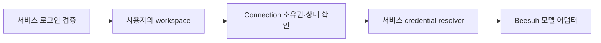

# Amp Labs connectors 설계 참고

검토 기준: [amp-labs/connectors, `70cfcb9`](https://github.com/amp-labs/connectors/tree/70cfcb9ca905dd569df55544223377a6aeff9221).
이 문서는 확인한 구조와 Beesuh의 인증 client 주입 경계를 구분한다.
Amp SDK 의존성은 추가하지 않았다. Beesuh에는 같은 방향의 작은 `auth` package가 있으며,
서비스가 인증 client를 주입하는 데만 쓴다.

## 확인한 구조

| Amp의 구조 | 확인한 역할 | 우리 쪽 적용 |
| --- | --- | --- |
| [ProviderInfo / Support](https://github.com/amp-labs/connectors/blob/70cfcb9ca905dd569df55544223377a6aeff9221/providers/types.gen.go) | 인증 방식·주소·메타데이터·지원 작업을 기술하는 공급자 카탈로그 | 공급자 정의와 사용자의 로그인 Connection을 분리한다. 카탈로그 등록을 모든 작업의 구현으로 간주하지 않는다. |
| [ConnectorParams](https://github.com/amp-labs/connectors/blob/70cfcb9ca905dd569df55544223377a6aeff9221/common/params.go) | 인증된 클라이언트, 공급자 workspace, 연결별 메타데이터를 주입 | 서비스가 사용자/연결 권한을 확인하고 만든 실행 문맥만 어댑터에 전달한다. |
| [AuthenticatedHTTPClient](https://github.com/amp-labs/connectors/blob/70cfcb9ca905dd569df55544223377a6aeff9221/common/auth.go) | 인증 처리를 감춘 HTTP 호출 경계 | `auth.HeaderClient` 또는 서비스가 만든 OAuth HTTP client를 model 설정에 주입한다. |
| [OAuth TokenSource / WithTokenUpdated](https://github.com/amp-labs/connectors/blob/70cfcb9ca905dd569df55544223377a6aeff9221/common/oauth.go) | 토큰 취득·갱신과 변경 통지를 분리 | `auth.OAuthClient`가 token source와 persistence callback을 받아 바뀐 token을 요청 전에 저장한다. |
| [선택적 capability 인터페이스](https://github.com/amp-labs/connectors/blob/70cfcb9ca905dd569df55544223377a6aeff9221/connectors.go) | Read, Write, Delete, Subscribe, AuthMetadata 등 구현한 작업만 제공 | 사용자 권한과 실제 지원 작업의 교집합만 도구로 노출한다. 거대한 공통 Connector 인터페이스를 만들지 않는다. |
| [generic connector](https://github.com/amp-labs/connectors/blob/70cfcb9ca905dd569df55544223377a6aeff9221/generic/connector.go) | 카탈로그와 인증 클라이언트로 기본 호출 경계를 구성 | 기본 인증 연결과 공급자별 도메인 작업 구현을 구분한다. |
| [ReadParams / ReadResult](https://github.com/amp-labs/connectors/blob/70cfcb9ca905dd569df55544223377a6aeff9221/common/types.go) | 페이지 단위 결과, opaque cursor, 완료 여부 | 향후 데이터 수집 adapter의 참고다. Beesuh는 데이터 수집·스케줄·체크포인트를 제공하지 않는다. |
| [ErrorClass](https://github.com/amp-labs/connectors/blob/70cfcb9ca905dd569df55544223377a6aeff9221/common/errorclass.go) | 인증 거절, 권한 부족, rate limit 등 실패 원인을 구분 | 로그인 실패와 일시 장애를 구분하고, 부작용 여부가 불확실한 실행은 자동 재시도하지 않는다. |

Amp README도 API 호출 라이브러리와 인증 흐름·스케줄 실행 등을 제공하는 플랫폼을
[구분한다](https://github.com/amp-labs/connectors/blob/70cfcb9ca905dd569df55544223377a6aeff9221/README.md).
라이브러리를 도입해도 우리 서비스의 사용자 로그인·연결 소유권 관리가 대체되지는 않는다.
예를 들어 [Anthropic 카탈로그](https://github.com/amp-labs/connectors/blob/70cfcb9ca905dd569df55544223377a6aeff9221/providers/anthropic.go)는
API key와 proxy 지원을 선언하지만 Read/Write/Subscribe는 지원하지 않는다고 명시한다.
따라서 이 저장소의 Anthropic 등록을 Beesuh의 모델 메시지·도구 호출 어댑터 대체로 보지 않는다.

## Beesuh에서 유지할 경계

- **서비스 로그인 세션**은 서비스가 검증한다. 장기 Connection과 예약 작업은 안정적인
  user/workspace에 귀속하며, 브라우저 세션 ID를 로그인 계정의 식별자로 저장하지 않는다.
- **공급자 정의**는 프로토콜·모델·지원 작업을 설명한다. **Connection**은 누구의 계정인지,
  어떤 credential reference와 상태를 사용할지 설명한다. 같은 정의로 여러 사용자의
  Connection을 만들 수 있으며, 실제 자격 증명은 매 호출 해당 Connection으로 해석한다.
- **공급자의 workspace/tenant**와 **우리 서비스의 workspace**는 다르다. 향후 OAuth
  connector의 tenant 식별자는 post-auth 검증 결과로 취급하고, 우리 workspace 권한을
  사용자가 입력한 공급자 tenant 값에서 유도하지 않는다.

현재 구현의 `RequireIdentity`, `Authorize`, `ResolveCredential`, `CredentialRef`,
`AccountID`, `Generation`과 사용자별 journal/memory 격리는 이 방향을 유지한다.
`Credential.HTTPClient`는 service-owned, connection-scoped 모델 인증 client다.
`Credential.APIKey`는 하위 호환 경로로 즉시
`auth.HeaderClient`로 변환된다. `auth.OAuthClient`는 source/persist를 request transport에
묶고, client 안에서는 source와 persistence를 직렬화한다.

이는 OAuth callback UI, provider별 authorization-code flow, service secret store,
process 간 refresh lease, 모든 SaaS capability framework를 구현했다는 뜻은 아니다. 그들은
서비스/connector adapter의 책임으로 남는다.

## 실제 OAuth 커넥터를 추가할 때의 순서

1. 공급자 정의에 인증 방식과 실제 지원 작업을 선언한다. 지원 작업 자체가 사용자에게
   권한을 부여하지는 않으며, granted scopes와 서비스 정책도 함께 확인한다.
2. 서비스가 로그인 완료 후 계정·tenant·허용 scope를 검증한다. Amp의 선택적
   `GetPostAuthInfo`와 `PostAuthInfo.ProviderWorkspaceRef`는 이 단계의 참고 사례다.
   `AccountID`를 서비스 사용자 ID나 API key의 hash로 대신하지 않는다.
3. 서비스 cache가 credential reference와 account version별로 인증 HTTP client를 하나
   재사용한다. `auth.OAuthClient`의 TokenSource가 갱신하고 persistence callback이 실제로
   바뀐 token을 request 전에 저장한다. 여러 process가 같은 credential reference를 공유하면
   secret store CAS/lease로 process 간 refresh owner도 하나로 둔다. client 내부의 직렬화만으로
   process 간 refresh 경쟁까지 해결된다고 가정하지 않는다.
4. 인증이 실제로 무효화되었을 때만 `needs_login`으로 전환한다. 403은 권한 문제,
   429는 호출 제한으로 다룬다. secret store 장애나 네트워크 timeout을 로그인 만료로
   간주하지 않는다. 이 세부 오류 분류는 현재 Beesuh에서 모두 구현된 상태는 아니다.
5. 토큰 저장 version과 Beesuh `Generation`을 구분한다. 같은 계정의 정상 access-token
   갱신마다 대화의 generation을 올리지 않는다. 계정 교체·재인증·폐기는 별도로 관리한다.
6. 커넥터가 webhook을 받으면 원문 요청의 서명을 먼저 확인하고, 서비스에 등록된 binding으로
   수신 사용자를 찾는다. 입력 payload가 자기 소유자나 Connection 권한을 선언할 수는 없다.

DB, secret store, OAuth callback route, gateway scope 계약은 서비스 구현에 맞춰 정한다.
Beesuh에서 모든 SaaS 커넥터를 직접 실행하거나 임의 HTTP proxy를 모델 도구로 개방하는
변경은 하지 않는다. Amp를 실제 의존성으로 사용할지는 첫 SaaS의 필요한 capability와
그 구현을 확인한 뒤 결정한다.
